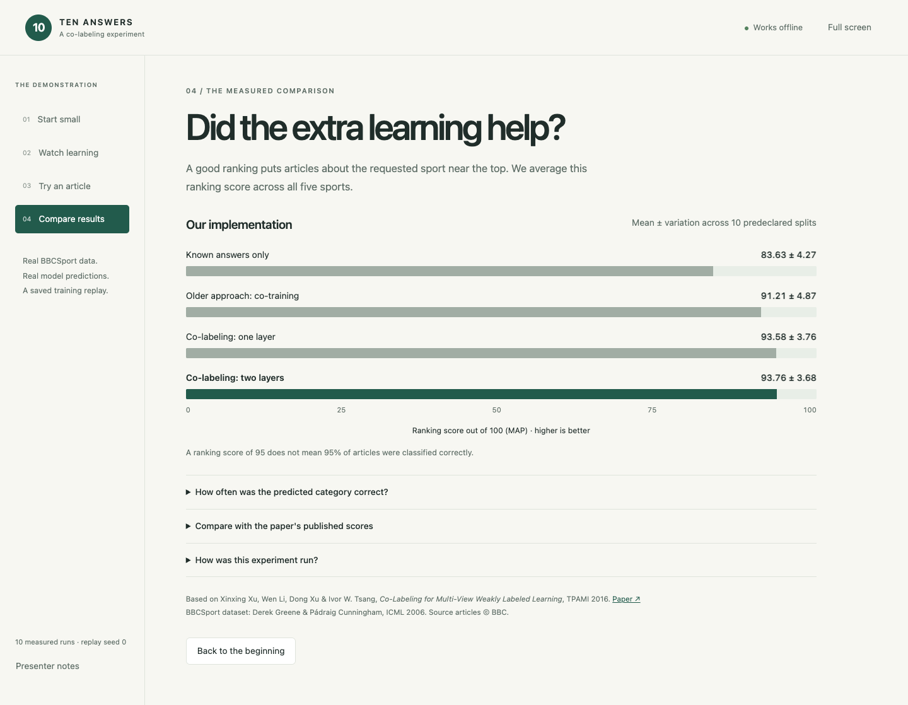

# Ten answers: BBCSport co-labeling

A classroom experiment and offline visual demo for **Co-Labeling for Multi-View Weakly Labeled Learning**, Xinxing Xu, Wen Li, Dong Xu and Ivor W. Tsang, TPAMI 2016, [DOI](https://doi.org/10.1109/TPAMI.2015.2476813).

This is an independent reimplementation, with genuine trained predictions. It includes the paper's two-view SSL candidate generation and label-dependent kernels, flat and grouped kernel learning, and two comparison methods. The authors' implementation was not available. Our measured scores and their published scores are clearly separated.



## Run during the presentation

On this Mac, **double-click `start_demo.command`**. A browser opens the local demo. Keep the terminal window open; press **Ctrl+C** there when finished. The presentation uses the included recording and does not need internet or training.

Or, in Terminal, from this repository:

```sh
source .venv/bin/activate
python run_demo.py
```

Open **http://127.0.0.1:8765** if the browser does not open automatically. If that address is occupied:

```sh
python run_demo.py --port 8766
```

The four chapters show the ten supplied answers, a replay of learning, a genuinely separate test article, and measured results. **Next round** advances real saved predictions; it does not invent or retrain them. Select **Find a changed guess** to find a test article whose prediction changed, then **Reveal the real answer**. Some predictions can remain wrong.

Keyboard shortcuts: **1–4** changes chapters; **left/right arrows** changes learning rounds in chapter 2; **space** plays/pauses. **Full screen** helps on a projector. A short speaking script is in [PRESENTATION.md](PRESENTATION.md).

## First setup on another computer

You need Python **3.12 or newer**, available as `python`. On macOS, double-click `setup.command` once while online. It creates `.venv`, installs the pinned packages, downloads the original dataset and checks the implementation. Then use `start_demo.command`.

Equivalent commands for macOS, Linux or Windows Terminal:

```sh
python -m venv .venv
# macOS / Linux:
source .venv/bin/activate
# Windows PowerShell instead:
# .venv\Scripts\Activate.ps1
python -m pip install -r requirements.lock.txt
python download_data.py
python -m pytest -q
python run_demo.py
```

The saved predictions also work without the source dataset; original headlines/excerpts become available after downloading it. All model code, cached derived predictions, and instructions belong in Git. **`.venv`, source data, intermediate runs and credentials are excluded.**

## Repeat the experiment

Run this in advance, not during the talk:

```sh
source .venv/bin/activate
python download_data.py
python run_experiment.py --runs 10 --seed 0 --export-demo
```

This uses seeds 0–9, a separate stratified 50/50 training/test split per seed, two supplied labels per sport, and the same splits for all four methods. Each vocabulary is randomly divided into 2,306/2,307 words and separately L1-normalized. The experiment writes `outputs/experiment/results.json`, per-seed results, and the first seed's actual training recording. `--export-demo` replaces the browser recording with those measured results.

For a single-run check:

```sh
python run_experiment.py --runs 1 --output outputs/single-run
```

The main metric is **mean average precision (MAP)**, a ranking score out of 100. Classification accuracy is also reported, as a separate metric. Hidden training answers and test answers never enter a learner or parameter selection. Results are not tuned to match the paper.

See [REPRODUCTION.md](REPRODUCTION.md) for equations, assumptions, numerical validation and reproducibility limits. The generated [RESULTS.md](RESULTS.md) records this checkout's measured experiment.

## Files you may want

| File | Purpose |
|---|---|
| `start_demo.command` / `run_demo.py` | Start the presentation |
| `setup.command` / `download_data.py` | One-time setup |
| `run_experiment.py` | Repeat training and evaluation |
| `colabeling/solver.py` | The QP and kernel-weight learning |
| `colabeling/models.py` | Candidate exchange, history and baselines |
| `demo/` | Offline visual interface and genuine saved predictions |
| `tests/` | Independent numerical and data-split checks |

## Data and attribution

BBCSport contains 737 BBC articles and 4,613 term-count features across athletics, cricket, football, rugby and tennis. Source: [Derek Greene's dataset page](https://derekgreene.com/bbc/). Cite Greene & Cunningham, *Practical Solutions to the Problem of Diagonal Dominance in Kernel Document Clustering*, ICML 2006.

The dataset is for non-commercial/research use; original articles are copyright BBC. The repository stores derived word clues and predictions, not the original full article text. The original paper PDF stays in the parent project folder and is not redistributed here.
